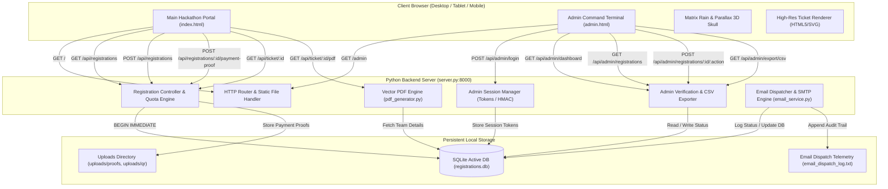

# SUPERNOVA Quantum Hack 2026 — Architecture & System Design

## 1. Executive Overview

**SUPERNOVA 2026** is a high-performance, self-contained hackathon registration, administration, and ticket issuance platform engineered for Tolani College of Commerce & Science (Department of Data Science & IT).

The application is architected with a **minimal-dependency, high-reliability design philosophy**:
- Zero heavy framework dependencies on the backend (standard Python 3 `http.server` + `sqlite3`).
- Pure browser-native frontend with Tailwind CSS utility rendering, dynamic DOM state machines, Canvas 2D matrix skull animation, and client-side vector graphics generation.
- Full ACID transaction guarantees for registration quotas and race-condition immunity.

---

## 2. System Architecture & Component Diagram

---

## 3. Request Flow & Lifecycles

### 3.1 Team Registration Lifecycle
1. **Live Slot Polling:** Client frontend polls `GET /api/registrations` every 30 seconds to fetch real-time slot availability for Web Debugging (15 slots) and AI/ML (25 slots).
2. **Payload Validation:** When submitting the registration form (`POST /api/registrations`), the backend performs strict validation:
   - Track legitimacy (`web` or `ai`).
   - Leader name (2–100 chars), valid email regex, and 10–15 digit phone.
   - College / institution name.
   - Team size validation: Strictly Duo (2 members) or Trio (3 members).
   - Member roster uniqueness (duplicate emails within submission rejected).
   - Mandatory terms and telemetry acceptance.
3. **Atomic Quota Check & Reservation:**
   - Server issues SQLite `BEGIN IMMEDIATE` to lock the transaction.
   - Checks if an email is already registered. If yes, safely returns the existing registration record without creating duplicates.
   - Verifies remaining capacity for the chosen track.
   - Generates unique reference ID: `SN26-` + 10-char hex (`SN26-XXXXXXXXXX`).
   - Inserts team into `teams` table and each hacker into `members` table.
   - Commits transaction.
4. **Instant Provisional Receipt:** Frontend displays confirmation screen with Reference ID, slot hold, instructions, and provisional receipt text download (`.txt`).
5. **Confirmation Email:** Asynchronous email dispatch via `email_service.py` sends registration acknowledgement.

### 3.2 Payment Proof & Admin Verification Lifecycle
1. **Payment Proof Upload:** Team uploads UPI transaction ID and screenshot proof via `POST /api/registrations/:id/payment-proof`. File is validated (PNG/JPG only, magic byte check, size < 8MB) and saved to `uploads/proofs/`.
2. **Admin Review:** Organizers log into `http://localhost:8000/admin`.
   - Admin views real-time telemetry dashboard, pending reviews, and registration lists.
   - Inspects uploaded screenshot proofs via modal.
   - Performs action:
     - `verify-payment` -> transitions `payment_status` to `PAID`.
     - `approve-registration` -> transitions `verification_status` to `VERIFIED` and `ticket_status` to `CONFIRMED`.
3. **Automated Audit Logging:** Every admin decision is recorded in `admin_actions` table with timestamp, admin username, previous status, and notes.
4. **Ticket Pass Unlock:** Once both payment is `PAID` and verification is `VERIFIED`, `is_eligible` becomes `True`.
   - The team can view and download their official landscape ticket pass (`/?ref=SN26-...`).
   - Vector PDF pass is dynamically rendered and downloadable via `GET /api/ticket/:id/pdf`.
   - Client can also export a 2.5x high-res PNG or print directly using `@media print` CSS.

---

## 4. Database Architecture (`registrations.db`)

The active SQLite database contains 6 relational tables:

| Table Name | Primary Purpose | Record Count |
|---|---|---|
| `teams` | Master registration records, track selection, payment status, verification status, proof metadata, and fee | Active live records |
| `members` | Individual team member details (name, email, phone, college, role: leader/member) linked by `team_id` | Foreign-key linked to `teams.id` |
| `admin_actions` | Immutable audit log of all organizer approvals, rejections, reviews, and status changes | Linked to `team_id` |
| `email_dispatches` | Telemetry log of all outgoing confirmation and ticket emails (status, error messages, sent timestamp) | Linked to `team_id` |
| `admin_sessions` | Cryptographic session tokens (`secrets.token_urlsafe(32)`) for authenticated organizers | TTL-managed |
| `sqlite_sequence` | Internal SQLite autoincrement sequence tracker | Internal |

---

## 5. Security & Reliability Measures

1. **Path Traversal Protection:** Static file router resolves canonical paths (`Path.resolve()`) and verifies they are strict descendants of project `ROOT`.
2. **Sensitive File Masking:** Requests attempting to fetch `.db`, `.sqlite`, `.py`, `.env`, or `.txt` files return `403 Forbidden` or `404 Not Found`.
3. **Race Condition Prevention:** SQLite `BEGIN IMMEDIATE` ensures that two simultaneous registrations cannot exceed track capacities.
4. **Input Sanitization:** Multi-stage validation rejects malformed payloads, oversized strings, and non-image uploads.
5. **Session Security:** Admin session tokens are cryptographically generated with `secrets.token_urlsafe(32)`, verified on all `/api/admin/*` routes, and cleared on logout.
6. **MIME & Header Security:** All responses emit `X-Content-Type-Options: nosniff` and appropriate `Cache-Control` headers.
